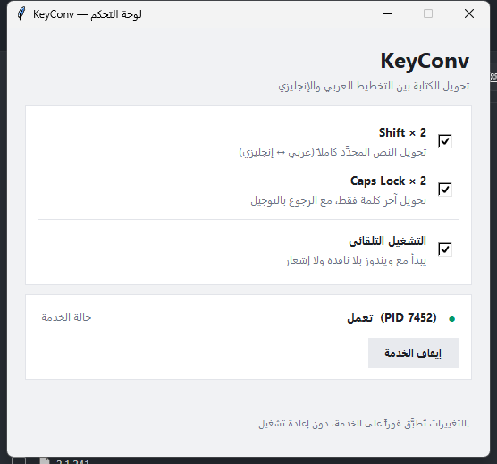

<p align="center">
  
</p>

<h1 align="center">KeyConv</h1>

<p align="center"><b>تحويل الكتابة بين التخطيط العربي والإنجليزي — ويندوز 10/11</b></p>

<p align="center">
  <a href="https://github.com/yousefwa7eed/KeyConv/releases/latest">⬇ <b>تحميل KeyConv.exe</b></a>
</p>

<p align="center">
  <a href="https://github.com/yousefwa7eed/KeyConv/releases/latest"></a>
  
  
</p>



## التحميل والتشغيل

1. نزّل **[KeyConv.exe](https://github.com/yousefwa7eed/KeyConv/releases/latest)** — ملف واحد فقط.
2. شغّله مباشرة؛ لا يحتاج تثبيت Python ولا أي برامج أخرى.
3. لو ظهر تحذير **SmartScreen** (الملف غير موقّع رقمياً): **More info** ← **Run anyway**.
4. من اللوحة اضغط **تشغيل الخدمة**، وفعّل **التشغيل التلقائي** إن أردت أن يبدأ مع ويندوز.

## الاستخدام

| الاختصار | الوظيفة |
|---|---|
| **Shift × 2** مع تحديد نص | يحوّل النص المحدَّد كاملاً إلى اللغة الثانية (عربي ↔ إنجليزي). |
| **Shift × 2** بدون تحديد | يحوّل آخر كلمة فقط إلى اللغة الثانية. تكرار الاختصار يعكس التحويل. |
| **Ctrl + C + رقم (1–9)** | نسخ إلى فتحة مؤقتة. |
| **Ctrl + V** | لصق آخر نسخ عادي. |
| **Ctrl + رقم (1–9) ثم V** | لصق الكلمة المحفوظة في ذلك الرقم. |

مثال: كتبت `اهلا` على تخطيط عربي وأنت تقصد `high` → اضغط **Shift × 2** فتُستبدل فوراً.

## ملاحظات

- الخدمة تعمل في الخلفية بلا نافذة؛ اللوحة للتحكم فقط.
- الإعدادات والسجل في `%LOCALAPPDATA%\KeyConv`.
- الفتحات مؤقتة وتُمسح عند إعادة تشغيل الخدمة.
- أثناء تفعيل ميزة الفتحات تُحجز اختصارات **Ctrl + رقم (1–9)** لنفسها (مثل تبديل تبويبات المتصفح)، لأنها بداية اختصار اللصق.
- كل الميزات قابلة للإيقاف من اللوحة، والتغييرات تُطبَّق فوراً دون إعادة تشغيل.

## التشغيل من المصدر

```powershell
python -m pip install -r requirements.txt
python keyconv.py
```

يتطلب Python 3.10+. لبناء `KeyConv.exe` راجع [BUILD.md](BUILD.md).

## ملاحظات تقنية

- يعمل على ويندوز 10/11 فقط (خطافات لوحة المفاتيح والحافظة).
- التحويل يتم بالكود المصدري كاملاً محلياً — لا اتصال بأي خدمة خارجية.
- الملف غير موقّع رقمياً، ولذلك يظهر تحذير SmartScreen عند أول تشغيل.
